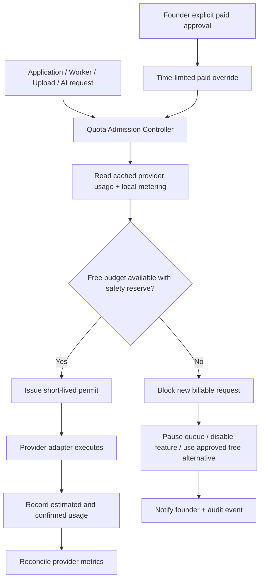

# 18 — Zero-Cost Guard, Free-Tier Quota Governance & Paid-Service Lock

**Priority:** P0 — foundational financial safety requirement  
**Default policy:** `ZERO_COST_ONLY`  
**Paid-service permission:** OFF  
**Automatic upgrade / auto top-up:** OFF  
**Last provider documentation review:** 14 November 2026

## 1. Mandatory business rule

Aknja Digital must operate within explicitly configured free allowances by default. It must not automatically:
- upgrade an account or resource to a paid plan;
- enable pay-as-you-go;
- add or use a payment method;
- activate paid compute, storage, bandwidth, AI, speech, email or automation;
- switch to a provider whose next request can create a charge;
- continue a billable workload after the free allowance is exhausted.

A paid service may be enabled only after the founder explicitly approves the provider, resource, plan, maximum monthly spend, start/end date and purpose. Approval is not implied by adding an API key or payment card.

## 2. Important limitation: application-side protection is not a provider billing guarantee

Aknja can stop its own requests and jobs, but it cannot guarantee zero charges if:
- provider metrics are delayed or incomplete;
- an already-issued request continues after the app disables new requests;
- a public URL or direct SDK credential bypasses the Aknja gateway;
- a provider automatically changes plan when a payment method is added;
- a provider charges for usage that is not represented by the available metrics endpoint.

Therefore use two layers:
1. **Provider/account safeguards:** do not add payment methods to free-only accounts unless provider behaviour is fully understood; disable auto-upgrade/top-up; set provider-side budget/alerts where available; restrict credentials and account permissions.
2. **Aknja internal enforcement:** central metering, conservative safety reserve, admission control, circuit breaker, job cancellation and fail-closed behaviour.

Never label an integration “zero-cost guaranteed” unless provider-side terms and account configuration actually support that guarantee.

## 3. Zero-Cost Guard architecture

### Required components

- `ProviderRegistry`: provider, product, account, plan, region, quota, pricing unit, billing state, verification date.
- `QuotaMeter`: local request, byte, token, character, operation and compute counters.
- `ProviderUsageAdapter`: fetch official usage metrics where the provider exposes them.
- `QuotaReconciler`: compare local estimate with provider-reported usage; use the higher value for protection.
- `QuotaAdmissionController`: allow/deny a new operation before it starts.
- `CircuitBreaker`: open when threshold is reached, metrics are stale or usage cannot be determined safely.
- `PaidOverride`: explicit, time-limited founder approval with maximum spend.
- `NotificationService`: alerts at thresholds and when a feature is paused.
- `AuditLedger`: append-only record of usage, block, reset, override and provider-plan changes.

## 4. Default thresholds and fail-safe policy

Thresholds are configurable per provider/resource. Suggested defaults:

| Level | Usage vs free allowance | Behaviour |
|---|---:|---|
| Green | 0–69% | Normal free operation |
| Notice | 70% | Dashboard notice |
| Warning | 80% | Alert founder; reduce optional/background work |
| Critical | 90% | Stop non-essential uploads, AI batches, analytics refresh and optional jobs |
| Hard stop | 95% estimated usage | Block new optional/billable requests; pause queue |
| Provider limit | 100% | Must not intentionally reach; provider may reject/suspend or charge depending on plan |

A 5–10% reserve is not sufficient where provider metrics are delayed. Use a configurable conservative reserve; default 10% for well-instrumented usage and 20% where metrics are delayed/estimated. The stricter of percentage and absolute reserve applies.

**Fail closed:** if usage cannot be measured, API credentials expire, provider metrics become stale, quota reset date is unknown, or plan/billing state changes unexpectedly, block new potentially billable calls until reconciled or manually approved.

## 5. Provider-specific metering and known limitations

### Cloudflare R2

Meter:
- Standard and Infrequent Access storage bytes.
- Class A and Class B operation counts.
- Upload bytes and download bytes.
- Multipart uploads and incomplete upload cleanup.
- Per-bucket and account-level usage where available.

Official data paths:
- R2 GraphQL Analytics datasets: `r2OperationsAdaptiveGroups`, `r2StorageAdaptiveGroups`, `r2BandwidthUsageAdaptiveGroups`.
- Account-level REST metrics endpoint: `GET /accounts/{account_id}/r2/metrics` provides storage/object metrics.
- Metrics/analytics documentation: https://developers.cloudflare.com/r2/platform/metrics-analytics/
- REST metrics: https://developers.cloudflare.com/api/resources/r2/subresources/buckets/subresources/metrics/

Limitations:
- Analytics API time range is limited to 31 days.
- Bandwidth dataset excludes transfers smaller than 100 KiB.
- Account-level storage metrics may not immediately reflect the latest data.
- The application must not assume provider metrics are instantaneous.

Enforcement:
- All uploads/downloads must pass through a central storage gateway or use narrowly scoped, short-lived presigned URLs with an Aknja-issued quota permit.
- Do not expose long-lived R2 credentials to browsers.
- Count bytes at the application gateway; reconcile with provider analytics.
- Before upload, reserve estimated object size plus safety margin; reject if it crosses the internal storage cap.
- At critical threshold, disable new uploads and optional file transformations. Keep authorised downloads available only if they cannot create a billable overage; otherwise pause and ask founder.
- Abort multipart uploads and apply retention/lifecycle policies.
- R2 free allowance is monthly included usage, not a guarantee that provider-side overage billing is automatically disabled. Verify billing/account settings.

### Neon PostgreSQL

Meter:
- Compute usage (CU-hours or provider equivalent).
- Database storage.
- Public/private network transfer.
- Branches and snapshots where applicable.
- Current plan, project quota and reset date.

Official consumption metrics API:
- `/consumption_history/v2/projects` and `/consumption_history/v2/branches` are documented for usage-based Launch, Scale, Agent and Enterprise plans, not as a universal Free-plan API.
- Guide: https://neon.com/docs/guides/consumption-metrics
- Free plan guidance: https://neon.com/blog/how-to-make-the-most-of-neons-free-plan

Free-plan handling:
- Do not assume the paid-plan consumption API is available for Free projects.
- Use provider Console usage data for periodic reconciliation.
- Estimate database size with PostgreSQL catalog/database-size queries.
- Meter application-observed response bytes and query/job activity; label these as estimates, not provider-confirmed network transfer.
- Track compute activity conservatively; avoid frequent polling that wakes a scale-to-zero compute endpoint.
- Set conservative compute size and idle/scale-to-zero settings where supported.

Enforcement:
- At 80%, reduce nonessential queries, polling, background jobs and verbose audit payloads.
- At 90–95%, pause analytics, AI-generated reports, bulk exports and noncritical writes.
- Preserve core business data and transactional integrity. Do not abruptly terminate an in-flight database transaction.
- If database quota is exhausted or provider suspends compute, switch the application to a controlled maintenance/read-only mode and notify founder. Do not automatically move production data to an unapproved paid DB.

### Upstash Redis

Current published Free plan on pricing page lists:
- 256 MB data size.
- 10 GB monthly bandwidth.
- 500K monthly commands.
- One Free database on the displayed plan comparison (check account-specific entitlement; pricing page FAQ may mention different account-level creation allowance).

Critical billing behaviour:
- Upstash documents that adding a payment method upgrades all free resources on the account to Pay-as-you-Go; an account with a payment method cannot keep or create free databases.
- Do not add a card to a Free-only Upstash account unless the founder explicitly approves the account-wide plan change.
- Pricing: https://upstash.com/pricing/redis
- Upgrade behaviour: https://upstash.com/docs/redis/howto/upgrade-database

Meter:
- Count every application command by command class.
- Track approximate request/response bytes and current data size.
- Reconcile with provider dashboard metrics.
- Apply local per-minute and monthly caps.

Enforcement:
- At threshold, stop cache warming, analytics, noncritical queues and optional background jobs.
- Do not use Redis as the only durable queue or source of truth.
- If Redis is blocked, fall back to database-backed jobs only if that path is capacity-tested; otherwise pause jobs safely.

### OCI

Meter:
- A1 OCPU/RAM and VM count.
- E2.1.Micro count.
- Boot/block volume total.
- Outbound data transfer.
- Public IPs, backups and any paid service.
- Tenancy limits, quotas, usage and billing.

Official docs:
- Always Free resources and tenancy limits: https://docs.oracle.com/en-us/iaas/Content/FreeTier/freetier_topic-Always_Free_Resources.htm
- Usage API: https://docs.oracle.com/en-us/iaas/api/
- Budgets are soft limits and alerting mechanisms; they do not themselves prevent a resource from exceeding the budget: https://docs.oracle.com/en/solutions/oci-best-practices/track-and-manage-usage1.html

Enforcement:
- Never create paid shapes or paid services automatically.
- Infrastructure-as-code must use an allow-list of approved Always Free shapes/resources.
- Before provisioning, query/verify tenancy limits and remaining capacity; require founder confirmation.
- OCI budget alerts are supplementary only. Use application/automation controls to prevent new resource creation.
- No automatic VM destruction/recreation to chase capacity.

### AI and speech APIs

Meter per provider/model:
- Input/output tokens or characters.
- Audio minutes, image/video units, requests.
- Model-specific free quota and rate limits.
- Provider plan, privacy classification and quota reset time.

Enforcement:
- Default `AI_PROVIDER_ENABLED=false` until provider is verified.
- Use a model/provider allow-list by data classification.
- Stop at internal threshold; do not rotate accounts/API keys to evade quota.
- Do not automatically fall back to a paid model.
- If all approved free providers are unavailable, return “AI service temporarily paused” while core manual workflows continue.
- Never send confidential client data to a free tier unless terms and client authorization permit it.

## 6. Central settings and database records

Required tables (or equivalent models):

### `provider_accounts`
`id`, `provider`, `account_label`, `account_reference`, `plan_name`, `billing_state`, `payment_method_present`, `auto_upgrade_enabled`, `region`, `verified_at`, `verified_by`, `status`.

Do not store full card numbers or payment credentials.

### `provider_products`
`id`, `provider_account_id`, `product_code`, `resource_id`, `free_allowance_json`, `meter_unit`, `reset_period`, `pricing_reference_url`, `provider_metrics_available`, `metrics_delay_seconds`, `enabled`.

### `quota_snapshots`
`id`, `provider_product_id`, `period_start`, `period_end`, `metric_key`, `provider_reported_value`, `locally_metered_value`, `effective_value`, `allowance`, `remaining_estimate`, `confidence`, `observed_at`, `source`.

### `usage_events`
`id`, `provider_product_id`, `operation`, `quantity`, `unit`, `project_id`, `actor_type`, `request_id`, `estimated_cost_minor`, `occurred_at`.

### `quota_policies`
`id`, `provider_product_id`, `mode`, `notice_percent`, `warning_percent`, `critical_percent`, `hard_stop_percent`, `reserve_percent`, `max_monthly_cost_minor`, `paid_override_allowed`, `enabled`.

### `paid_overrides`
`id`, `provider_product_id`, `approved_by`, `reason`, `max_spend_minor`, `valid_from`, `valid_until`, `approved_at`, `revoked_at`, `approval_payload_hash`.

### `quota_incidents`
`id`, `provider_product_id`, `incident_type`, `threshold`, `observed_usage`, `action_taken`, `resolved_by`, `resolved_at`, `created_at`.

## 7. Paid-service approval workflow

A paid override request must show:
- Provider and exact product.
- Why the free quota is insufficient.
- Current usage and projected usage.
- Exact plan and pricing URL.
- Maximum monthly spend in INR.
- One-time vs recurring cost.
- Data/privacy implications.
- Start and expiry time.
- Which feature will be enabled.

Founder must explicitly confirm. Approval must be time-limited and bound to the exact provider/product/limit. Any plan change invalidates the approval. No AI agent can approve this workflow.

Default values:
- `paid_service_mode = false`
- `auto_upgrade = false`
- `auto_top_up = false`
- `max_monthly_paid_spend = INR 0`
- `paid_override_requires_super_admin = true`

## 8. User interface requirements

Add a **Cost & Quota Control Centre** to the founder dashboard.

For each provider/product show:
- Free allowance.
- Current usage.
- Remaining estimated allowance.
- Percentage used.
- Reset date/time and timezone.
- Source: provider-confirmed / local estimate / manual.
- Last updated time and metric staleness.
- Confidence level.
- Current billing state.
- Payment method present: yes/no/unknown.
- Auto-upgrade state.
- Current circuit-breaker state.
- Features paused due to quota.
- “Request paid access” action (never auto-enabled).

Global indicators:
- Zero-cost mode: ON/OFF.
- Paid services: BLOCKED/APPROVED.
- Unknown/stale metrics: SAFE MODE.
- Provider outage and quota reset notifications.

Do not display an exact remaining balance as fact when the value is only an estimate. Label it “estimated remaining”.

## 9. Failure and reset behaviour

- On metric fetch failure: retain last known value, mark stale and fail closed for optional billable actions.
- On provider 429: exponential backoff; do not increase concurrency.
- On quota exceeded: open circuit breaker and pause queued work.
- On monthly reset: re-fetch provider plan and usage before automatically reopening. Do not assume reset happened solely from local calendar.
- On provider plan change or payment method addition: freeze integration until founder re-verifies.
- On reconciliation mismatch: use the higher usage estimate and create an incident.
- On app restart: load circuit-breaker state from durable DB, not in-memory cache only.

## 10. Acceptance tests (P0)

- [ ] Free-only mode is enabled by default on fresh installation.
- [ ] Paid APIs and paid model fallback are blocked by default.
- [ ] No agent can create paid override.
- [ ] At 70/80/90/95% thresholds, expected alerts and restrictions occur.
- [ ] A stale/unavailable usage metric blocks optional billable requests.
- [ ] R2 upload is denied when reserved quota would exceed the internal cap.
- [ ] Neon noncritical jobs pause while transactional data is protected.
- [ ] Upstash integration warns that adding a payment method upgrades all Free resources; payment method presence triggers a safety lock.
- [ ] A provider plan change triggers a safety lock.
- [ ] Queue workers re-check quota immediately before executing a provider call.
- [ ] Concurrent requests cannot oversubscribe quota (atomic reservation).
- [ ] Restart does not clear a hard-stop state.
- [ ] Monthly reset is reconciled with provider before reopening.
- [ ] Paid override requires explicit Super Admin approval, exact spend cap and expiry.
- [ ] Every block, alert, override and reset is audit logged.
- [ ] Tests prove no automatic paid fallback when free quota is exhausted.

## 11. Operating principle

**Free-first, quota-aware, fail-closed, no automatic paid upgrade.** When a free allowance is exhausted, pause the affected optional feature, preserve core data and notify the founder. Continue only after the quota resets, a genuinely free approved alternative is selected, or the founder explicitly authorizes a paid service.
